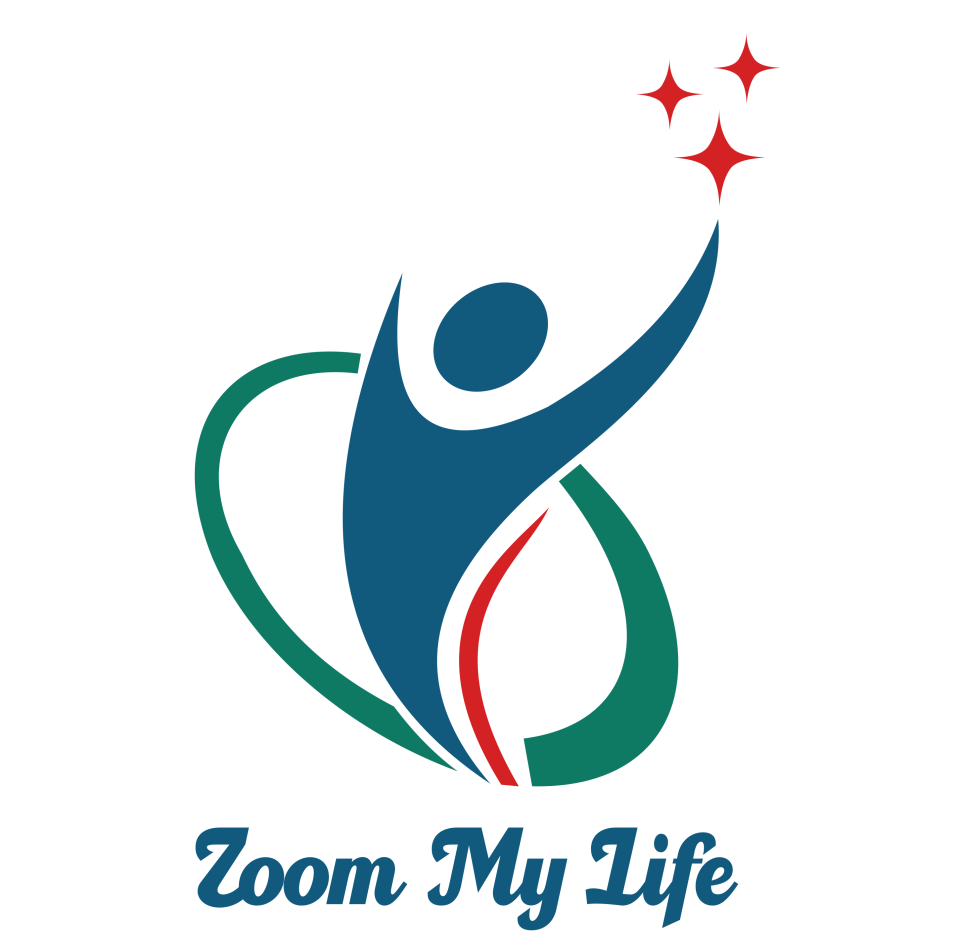

# Bloom: submission folder

Everything needed to submit Bloom to **Boat Hackathon SF 2026**. Deadline: **Fri 2026-11-20, 3:00 PM PT**. Submit at BoatHackathon.com/builders from the regular builder sign-in (not preview mode).

**Confidential · © 2026 Zoom My Life · Do not distribute.** Synthetic data only. Not a medical device. Not HIPAA compliant.

## Links for the form

| Field | Value |
| --- | --- |
| Project link | https://box-node-65cdd7262c0153ea-80.on.boat.dev/ (landing page with Patient and Doctor buttons) |
| Direct app links | Patient https://box-node-65cdd7262c0153ea-80.on.boat.dev/intake/ · Doctor https://box-node-65cdd7262c0153ea-80.on.boat.dev/doctor/ |
| Demo video link | Upload `bloom-demo-voiceover.mp4` to YouTube (unlisted), paste that link |
| X post link | Link to post 1/ of the thread |
| Logo | `bloom-logo-1024.png` |

Backup (only if the main one is down): https://box-node-ea80fef589949d9a-80.on.boat.dev/ (archives 2026-11-21 09:29 UTC).

## Files in this folder

| File | What it is |
| --- | --- |
| `captains-log.md` | Project description written as a captain's log, ready to paste |
| `form-answers.md` | Paste-ready answers for every form field, plus the pre-submit checklist |
| [`../submission.md`](../submission.md) | Captain's log, X thread text, 2-minute video script, prize checklist |
| `bloom-demo-voiceover.mp4` | **Demo video to submit** (1:54, captions + narration of each partner's role) |
| `bloom-demo.mp4` | Same video without narration (captions only) |
| `voiceover-script.md` | Narration text with start times and the partner used in each step |
| `demo-recording-plan.md` | Click-by-click plan used to record the video |
| `bloom-logo-1024.png`, `bloom-logo-512.png`, `bloom-logo.svg` | Bloom app logo (1024 px is the one to upload) |
| `presentation/bloom-partner-architecture.pdf` | Partner architecture deck, 14 slides (PDF) |
| `presentation/bloom-partner-architecture.html` | Same deck as a standalone web page (open in a browser) |
| `presentation/speaker-notes.md` | Speaker notes for each slide |
| `presentation/zoom-my-life-logo.png` | Logo used by the HTML deck |

The live, editable deck is at https://claude.ai/artifact/DqvMD5Xa87sjyDZD8sVBBH (private until shared).

## Related documents elsewhere in the repo

| File | What it is |
| --- | --- |
| [`../../README.md`](../../README.md) | How to use, run, deploy and test Bloom |
| [`../approvals/G4-release-check.md`](../approvals/G4-release-check.md) | Release check: 834 tests pass, analysis clean |
| [`../api-contract.md`](../api-contract.md) | HTTP API contract |
| [`../sponsor-runbook.md`](../sponsor-runbook.md) | Partner setup steps |
| [`../STATUS.md`](../STATUS.md) | Current status and open items |
